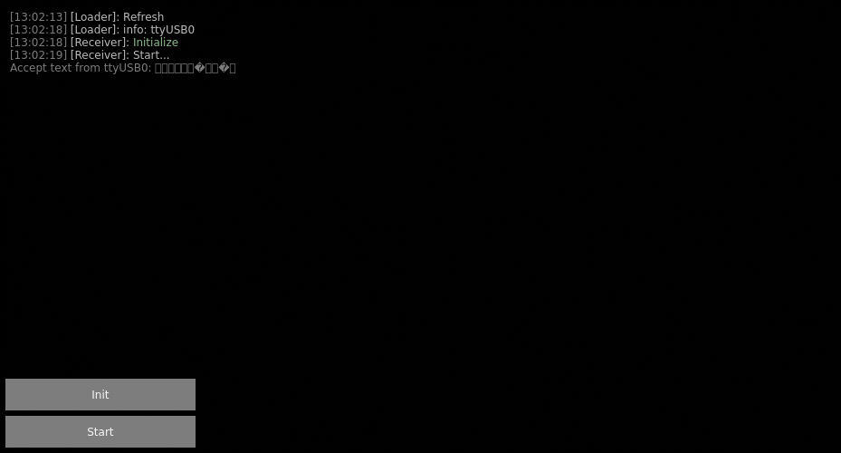
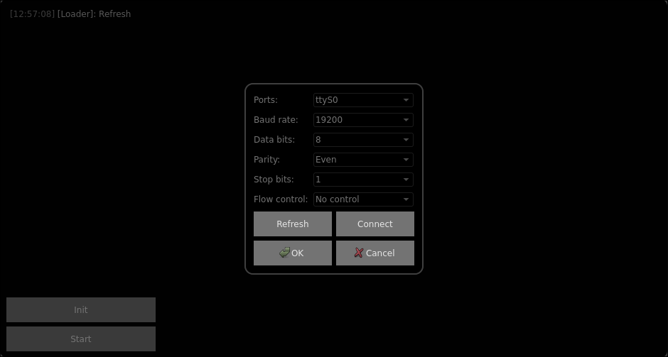

# DebugViaCom


A lightweight desktop serial monitor and data receiver built with **C++** and **Qt**. The core receiving and logging pipeline is currently under active development in `wip/class-dataReceiver`.




## Key Features

-   **Serial Port Configuration:** Select available ports (`comboPorts`) and configure connection parameters through the UI.
-   **Unified Settings Struct:** Packs port and connection options into an `info` struct before passing them to `DataReceiver`.
-   **Non-Delimiter Text Handling:** Parses incoming text streams reliably, including messages without a trailing newline (`\n`).
-   **Typed Logging:** Categorizes log messages (`typeLog`) and routes them to `logView` via Qt signals in real time.
-   **Execution Controls:** Start control flow with an integrated loading/activity indicator (`loader`).

## Technical Stack

-   **Language:** C++
-   **Framework:** Qt 6 (`Core`, `Widgets`, `SerialPort`)
-   **Build System:** CMake
-   **Architecture:** Decoupled `DataReceiver` class communicating with the UI (`logView`) through Qt signals and slots
-   **Environment:** Linux

## Roadmap

-   [x] Port selection and connection settings (`comboPorts`, `info` struct)
-   [x] Data reception without trailing `\n`
-   [x] Typed logging and `logView` signal integration
-   [ ] Complete refactoring of `DataReceiver` class (`wip/class-dataReceiver`)
-   [ ] Export logs to file

## How to Build and Run

### Prerequisites
You need a C++ compiler, CMake, and Qt 6 (with the `SerialPort` module installed).

```bash
# Clone the repository
git clone https://github.com/Ryeheck/DebugViaCom.git
cd DebugViaCom

# Configure and Build
cmake -B build -S .
cmake --build build

# Run the application
./build/DebugViaCom